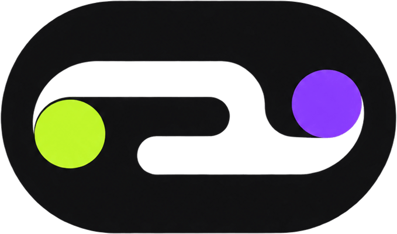

#  Global Payout Demo

<p>
  <a href="https://nextjs.org/"></a>
  <a href="https://www.typescriptlang.org/"></a>
  <a href="https://mongoosejs.com/"></a>
  <a href="https://tailwindcss.com/"></a>
  <a href="https://www.airwallex.com/docs"></a>
</p>

## What this is

Upload a contractor payment file. Each person is paid the amount on the file in their local currency. The app prices the available rails, keeps the cheapest, and submits one wallet-funded batch.

There is no login. Every call uses the Airwallex account for `AIRWALLEX_API_KEY`.

This is a demo on an Airwallex **sandbox** account, not a production system. Shortcuts are tagged in code and listed in [docs/08-demo-plan.md](docs/08-demo-plan.md). Product scope is in [docs/00-product-brief.md](docs/00-product-brief.md).

## Stack

Next.js App Router, MongoDB via Mongoose, Tailwind CSS. Airwallex is called from the server only.

## Deploy on Replit

Replit imports this repo and publishes the Next.js server. MongoDB stays on Atlas. The server reads [`.env.example`](.env.example).

1. Create a MongoDB Atlas cluster. Allow Replit’s egress (`0.0.0.0/0` is the usual sandbox choice) and copy `MONGODB_URI`. The process refuses to boot without it.
2. Import the repo: [replit.com/github/HeimLabs/airwallex-global-payout](https://replit.com/github/HeimLabs/airwallex-global-payout).
3. Set secrets in **both** the workspace Secrets tool and the deployment’s Secrets. Workspace secrets are not copied into a deployment. `NEXT_PUBLIC_*` must be present at build time.
4. For a real demo set `NEXT_PUBLIC_DATA_SOURCE=api` and `PAYMENTS_GATEWAY=airwallex`, plus `MONGODB_URI`, `SOURCE_CURRENCY=USD`, and the Airwallex values from [`.env.example`](.env.example) (`AIRWALLEX_ENV=sandbox`, `AIRWALLEX_CLIENT_ID`, `AIRWALLEX_API_KEY`). Set `DEMO_MODE=true` when you want the Advance control and `/dev/ui-kit`. Leave `NEXT_PUBLIC_DATA_SOURCE=mock` to click through the scripted file with no Airwallex keys.
5. Publish. Autoscale (the `.replit` default) can scale to zero and miss a webhook on a cold start. Choose a **Reserved VM** if webhooks must land while the app is idle. Opening the run still refreshes status from Airwallex.
6. In the Airwallex sandbox, set the webhook URL to `https://<slug>.replit.app/api/webhooks/airwallex`. Use the published host, not the `*.replit.dev` editor URL. The webhook secret is optional; the run page polls while a payout is in flight.

## Run locally

Node 22 or newer. Copy the example env, then start the dev server. With `NEXT_PUBLIC_DATA_SOURCE=mock` the pages do not call MongoDB or Airwallex. The example `MONGODB_URI` still has to be present, because the server checks it at boot.

```bash
cp .env.example .env
pnpm install
pnpm dev                  # http://localhost:3000
```

Set `NEXT_PUBLIC_DATA_SOURCE=api` and `PAYMENTS_GATEWAY=airwallex` when you want the real API, and fill in Mongo and Airwallex values.

The rest of the docs — contracts, Airwallex map, pages — start at [docs/README.md](docs/README.md).
