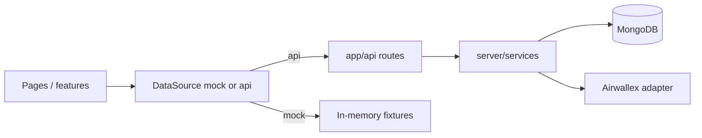

# 02 — Architecture

## Runtime

One Next.js process. MongoDB stores runs. The browser never calls Airwallex.



Pricing and submit run inside the request that triggers them. A sample file is at most 25 rows and two probes each, which fits one request. The route stays on the Node.js runtime.

```ts
// DEMO-ONLY: pricing and submit run inline in the route.
// PROD: put add / delete / quote / submit on a queue with the same request_id builders.
```

Status after submit is refreshed by `GET /api/runs/:id` (the page polls while `poll` is true). That handler reads Mongo and, if the run is still open, retrieves the batch and items from Airwallex and writes the result back. A webhook does the same write when configured. There is no second process.

## Layers

| Layer | Path | May import |
| --- | --- | --- |
| Contracts | `src/contracts` | zod, decimal.js. No server, no React |
| Mocks | `src/mocks` | contracts |
| UI kit | `src/ui` | React, contracts. Props only |
| Features | `src/features` | ui, contracts, TanStack Query. Calls a DataSource |
| Routes | `src/app` | features for pages; services for `app/api` |
| Services | `src/server/services` | domain, db, adapter interfaces |
| Domain | `src/server/domain` | contracts, decimal.js. Pure |
| DB | `src/server/db` | mongoose, contracts |
| Airwallex | `src/server/adapters/airwallex` | the HTTP client |

`src/contracts` is the only module both the UI and the server import. The CSV parser lives there so the mock and the server reject the same files.

Route handlers are thin: zod-parse the input, call a service, return the contract DTO or the error envelope. `export const runtime = 'nodejs'` on routes that touch Mongo or Airwallex.

No server actions. No data fetching in server components. `page.tsx` renders a client screen.

## Repo layout (target)

```
src/
  app/
    page.tsx                      # home
    runs/[id]/page.tsx
    dev/ui-kit/page.tsx
    api/runs/...
    api/balance/route.ts
    api/demo/runs/[id]/advance/route.ts
    api/demo/reset/route.ts
    api/webhooks/airwallex/route.ts
  contracts/
  mocks/
  ui/
    tokens/ primitives/ payout/ patterns/ format/
  features/
    data/                         # DataSource, hooks, query keys
    home/ run/
  server/
    domain/ services/ db/
    adapters/airwallex/
docs/
  samples/contractors.csv
public/samples/contractors.csv    # same file, copied in U5
```

## Environment

See `.env.example`. Zod validates this at server boot. The mock UI build does not need Airwallex variables.

| Name | Role |
| --- | --- |
| `AIRWALLEX_CLIENT_ID`, `AIRWALLEX_API_KEY` | Server only |
| `AIRWALLEX_BASE_URL` | Sandbox host by default |
| `AIRWALLEX_API_VERSION` | Sent as `x-api-version` on every call except login |
| `AIRWALLEX_ENV` | `sandbox` gates the simulation endpoint |
| `AIRWALLEX_WEBHOOK_SECRET` | Optional |
| `MONGODB_URI` | Runs |
| `SOURCE_CURRENCY` | Wallet currency. Default `USD` |
| `DEMO_MODE` | Enables `/dev/*` and `/api/demo/*` |
| `NEXT_PUBLIC_DATA_SOURCE` | `mock` or `api`. Build-time public flag |
| `PAYMENTS_GATEWAY` | `mock` or `airwallex`. Server-side. Tests use `mock` |

`NEXT_PUBLIC_DATA_SOURCE=mock` never reads `PAYMENTS_GATEWAY`. The pages behave the same.

## Auth

None. D-02. The key's account is the payer. Do not send `x-login-as` or `x-on-behalf-of`.

```ts
// DEMO-ONLY: every visitor operates the API-key account.
// PROD: authenticate the operator and authorise payouts before submit.
```

## Time

Quote expiry is compared using the server clock when a run is read or paid. The client displays `quote.expiresAt` and trusts the `quoteExpired` flag on the next response. Domain code that decides expiry takes a `now: Date` argument from the service so tests can pass a fixed time.

## Hosting

Out of scope. No Docker, Compose, or deploy scripts on the B track.
