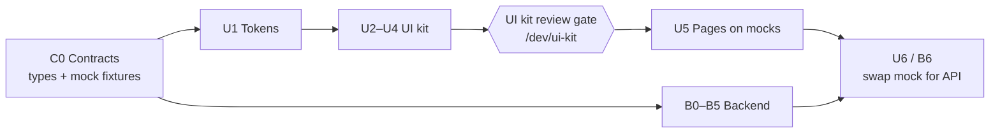

# Global Payout — Internal Docs

Internal implementation documentation for the **Global Payout** demo built on Airwallex.

> Upload a contractor payment file, pay everyone in their local currency through the cheapest rail.

The user drops a CSV. Each row is a person and the amount they must receive in their currency. The app prices the rails Airwallex can use for that corridor, keeps the one with the lowest source-currency cost, and shows the saving against the other rail. One confirmation submits a single wallet-funded batch. There is no login.

## Reading order

| # | Doc | What it answers |
| --- | --- | --- |
| 00 | [Product brief](./00-product-brief.md) | Who it's for, the flow, scope and non-goals |
| 01 | [Feasibility (Airwallex)](./01-feasibility-airwallex.md) | Which APIs, constraints, sandbox checklist |
| 02 | [Architecture](./02-architecture.md) | Process, layers, repo layout, env |
| 03 | [Contracts](./03-contracts.md) | **Frozen** CSV, states, DTOs, REST, errors, actions |
| 04 | [Airwallex integration](./04-airwallex-integration.md) | Endpoints, id builders, field mapping, status maps |
| 05 | [Design system](./05-design-system.md) | Tokens, type, tone |
| 06 | [UI kit spec](./06-ui-kit-spec.md) | Every component and the `/dev/ui-kit` review gate |
| 07 | [Pages spec](./07-pages-spec.md) | Home and run screen, copy, edge states |
| 08 | [Demo plan](./08-demo-plan.md) | Sample file, mock runs, simulate script |
| 09 | [Decisions](./09-decisions.md) | D-xx and Q-xx |

Agent rules: [`AGENTS.md`](../AGENTS.md) and `.cursor/rules/*.mdc`.

## Tracks

IDs (`U3.2`, `B4.1`, ...) go in PRs, commits, and tickets.

| Track | Doc | Scope |
| --- | --- | --- |
| **U — UI** | [tracks/U-track.md](./tracks/U-track.md) | Tokens → kit → review gate → pages on mock data |
| **B — Backend** | [tracks/B-track.md](./tracks/B-track.md) | Mongo, Airwallex client, pricing, submit, status sync |

### Sequencing

1. **C0 first.** Shared types and fixtures (`src/contracts`, `src/mocks`) match [03](./03-contracts.md). Both tracks import these and nothing else across the boundary.
2. **UI kit, then a review gate.** Tokens can be glanced at after U1. Pages do not start until the kit sign-off in [09](./09-decisions.md).
3. **Backend in parallel with the kit and the mock pages.** It must not change a DTO to suit an implementation shortcut. If Airwallex disagrees with a contract, stop and update [03](./03-contracts.md) and [09](./09-decisions.md) before continuing.
4. **Integration last.** `NEXT_PUBLIC_DATA_SOURCE=api` swaps the mock adapter for the REST client. The pages stay.

`NEXT_PUBLIC_DATA_SOURCE=mock` is the simulation mode. It needs no MongoDB and no Airwallex credentials.

## Glossary

| Term | Meaning |
| --- | --- |
| **Run** | One uploaded file and the batch created from it. |
| **Row** | One contractor line. |
| **Source currency** | Wallet currency that funds the batch (`SOURCE_CURRENCY`, default `USD`). |
| **Transfer currency** | Currency the contractor receives. Equals the CSV `currency`. |
| **Rail** | A `(transfer_method, local_clearing_system)` pair. `LOCAL` + `ACH`, or `SWIFT` + none. |
| **Cheapest rail** | The priced candidate with the lowest `amount_payer_pays` in the source currency. |
| **Probe** | A batch item added only to read a price, then deleted if it loses. |
| **Quote** | The locked FX summary on the draft batch (`POST .../quote`). |
| **You pay** | `amount_payer_pays`: transfer cost plus fees, in the source currency. |
| **They receive** | The CSV amount, in the contractor's currency. Fees are paid by us (`fee_paid_by: PAYER`). |
